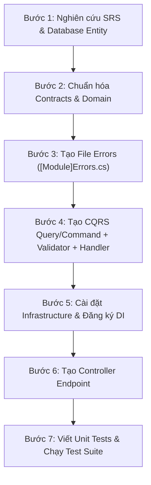

# NOVALIVE - DEVELOPMENT WORKFLOW & CODING STANDARDS
> **Phiên bản:** 1.0  
> **Áp dụng cho:** Toàn bộ Backend Developers (`NovaLive.Api`, `NovaLive.Application`, `NovaLive.Contracts`, `NovaLive.Domain`, `NovaLive.Infrastructure`, `Tests`)

---

## MỤC LỤC
1. [Nguyên Tắc Kiến Trúc (Architectural Principles)](#1-nguyên-tắc-kiến-trúc)
2. [Các Quy Tắc Khi Viết Code (Coding Rules)](#2-các-quy-tắc-khi-viết-code)
   - [2.1. Tầng Domain](#21-tầng-domain)
   - [2.2. Tầng Contracts](#22-tầng-contracts)
   - [2.3. Tầng Application (CQRS & Result Pattern)](#23-tầng-application)
   - [2.4. Tầng Infrastructure](#24-tầng-infrastructure)
   - [2.5. Tầng API & Controllers](#25-tầng-api--controllers)
3. [Quy Trình Chuẩn Triển Khai Một Feature Mới (Feature Workflow)](#3-quy-trình-chuẩn-triển-khai-một-feature-mới)
4. [Quy Chuẩn Viết Tests (Unit & Integration Testing)](#4-quy-chuẩn-viết-tests)
5. [Quy Chuẩn Git & Commit Message](#5-quy-chuẩn-git--commit-message)

---

## 1. NGUYÊN TẮC KIẾN TRÚC

Hệ thống tuân thủ nghiêm ngặt **Clean Architecture** kết hợp **CQRS** (Command Query Responsibility Segregation):

```
       [ NovaLive.Api ]
              │
       [ NovaLive.Contracts ] (DTOs bất biến)
              │
       [ NovaLive.Application ] (CQRS, Use Cases, Pipeline Behaviors)
         ┌────┴────┐
         ▼         ▼
  [ NovaLive.Domain ]   [ NovaLive.Infrastructure ]
  (Entities, Enums,      (EF Core, Redis, RabbitMQ,
   Errors, Result)        MinIO, External Adapters)
```

* **Quy tắc phụ thuộc một chiều (Dependency Rule)**:
  * `Domain` là trung tâm, **tuyệt đối không phụ thuộc** vào bất kỳ project hay thư viện bên ngoài nào.
  * `Application` chỉ phụ thuộc vào `Domain` và `Contracts`. Phụ thuộc hạ tầng thông qua Interface (`Abstractions/`).
  * `Infrastructure` phụ thuộc vào `Application` và `Domain` để cài đặt cụ thể.
  * `Api` là Entry Point, phụ thuộc vào `Application`, `Contracts`, và đăng ký DI của `Infrastructure`.

---

## 2. CÁC QUY TẮC KHI VIẾT CODE

### 2.1. Tầng Domain (`NovaLive.Domain`)
1. **Encapsulation (Đóng gói dữ liệu)**:
   * Tất cả Entity kế thừa từ `Entity` hoặc `AuditableEntity`.
   * Constructor mặc định là `private` (dành riêng cho EF Core).
   * Thuộc tính sử dụng `public Type Property { get; private set; }`.
   * **Không dùng public setter**. Mọi thay đổi trạng thái phải thông qua các Domain Method rõ nghĩa (ví dụ: `MarkAsShipping()`, `MarkAsDelivered()`, `UpdateStatusFromWebhook()`).
2. **Enum & Rbac**:
   * Định nghĩa Enum trạng thái trong `NovaLive.Domain.Common.Enums.cs`.
   * Tất cả Permission Code tập trung duy nhất tại `NovaLive.Domain.Rbac.PermissionCodes.cs` theo định dạng `module:action` (ví dụ: `shipping:calculate_fee`, `orders:fulfillment_own`).
3. **Quản lý Lỗi (Error Definition)**:
   * **CẤM** `throw Exception` cho các lỗi nghiệp vụ thông thường. Sử dụng `Result` và `Result<T>`.
   * Tách riêng class static `[Module]Errors.cs` tại tầng `Application` (hoặc `Domain`).

---

### 2.2. Tầng Contracts (`NovaLive.Contracts`)
1. **Dùng C# Record**:
   * Toàn bộ Request và Response DTO phải là `record` bất biến (Immutable).
   * Phân chia theo version và module: `NovaLive.Contracts.V1.[ModuleName]`.
2. **Không mang Logic**:
   * Contract chỉ chứa dữ liệu thuần túy (POCO/Record). Không chứa phương thức xử lý hay dependency nào.

---

### 2.3. Tầng Application (`NovaLive.Application`)

#### A. CQRS với MediatR:
* **Commands**: Dùng khi ghi/sửa dữ liệu:
  * Không trả dữ liệu: `public record DoSomethingCommand(...) : ICommand, ITransactionalCommand;`
  * Có trả dữ liệu: `public record DoSomethingCommand(...) : ICommand<ResponseDto>, ITransactionalCommand;`
* **Queries**: Dùng khi đọc dữ liệu:
  * `public record GetSomethingQuery(...) : IQuery<ResponseDto>;`

#### B. Phân quyền tự động (RBAC):
* Nếu Use Case yêu cầu quyền, implement `IRequirePermission`:
  ```csharp
  public record CalculateShippingFeeQuery(CalculateShippingFeeRequest Request)
      : IQuery<ShippingFeeResponse>, IRequirePermission
  {
      public string RequiredPermission => PermissionCodes.Shipping.CalculateFee;
  }
  ```
  *(Pipeline `AuthorizationBehavior` sẽ tự động xác thực và chặn 403 nếu thiếu quyền).*

#### C. Validation với FluentValidation:
* Mỗi Command/Query bắt buộc có 1 Validator tương ứng đặt cùng thư mục:
  ```csharp
  public sealed class DoSomethingCommandValidator : AbstractValidator<DoSomethingCommand>
  {
      public DoSomethingCommandValidator()
      {
          RuleFor(x => x.Request.ShopId).NotEmpty().WithMessage("Mã gian hàng không hợp lệ.");
          RuleFor(x => x.Request.WeightGram).GreaterThan(0).LessThanOrEqualTo(50_000);
      }
  }
  ```
  *(Pipeline `ValidationBehavior` sẽ tự động chặn và trả về `400 Bad Request` chứa chi tiết lỗi).*

#### D. Xử lý Lỗi & Tận dụng Implicit Operators (QUY TẮC BẮT BUỘC):
1. **Tách riêng file Error**: Tạo file static `[Feature]Errors.cs` (ví dụ: `ShippingErrors.cs`, `ProductErrors.cs`).
   ```csharp
   public static class ShippingErrors
   {
       public static readonly Error WarehouseNotFound =
           Error.NotFound("Shipping.WarehouseNotFound", "Không tìm thấy kho xuất hàng.");

       public static readonly Error InvalidShopWarehouse =
           Error.Validation("Shipping.InvalidShopWarehouse", "Kho hàng không thuộc gian hàng.");
   }
   ```
2. **KHÔNG `new Error(...)` trong Handler**:
   * ❌ **SAI**: `return Result<Response>.Failure(new Error(ErrorType.NotFound, "Code", "Message"));`
   * ❌ **DÀI DÒNG**: `return Result<Response>.Failure(ShippingErrors.WarehouseNotFound);`
   * ✅ **ĐÚNG & CHUẨN**:
     ```csharp
     if (warehouse is null)
         return ShippingErrors.WarehouseNotFound; // Implicit operator tự chuyển Error thành Result<T>

     return response; // Implicit operator tự chuyển T thành Result<T>.Success(response)
     ```

---

### 2.4. Tầng Infrastructure (`NovaLive.Infrastructure`)
1. **Bảo mật Webhook & Callback**:
   * Khi kiểm tra Secret Token hoặc HMAC-SHA256, **bắt buộc dùng constant-time comparison** để chống tấn công **Timing Attack**:
     ```csharp
     CryptographicOperations.FixedTimeEquals(receivedSecretBytes, expectedSecretBytes);
     ```
2. **External HTTP Clients (Resilience)**:
   * Đăng ký thông qua `services.AddHttpClient<IProvider, Adapter>()`.
   * Cấu hình Timeout rõ ràng (ví dụ: 15s).
   * Bọc lỗi từ API đối tác vào `Result.Failure(ShippingErrors.ProviderError(...))`, không để văng Unhandled Exception.
   * Cấu hình tham số (URL, Token, Secret) thông qua class `[Provider]Options` bind từ `appsettings.json`.

---

### 2.5. Tầng API (`NovaLive.Api`)
1. **Controller Kế Thừa `ApiControllerBase`**:
   ```csharp
   [Route("api/v1/[module]")]
   public sealed class ShippingController(ISender sender) : ApiControllerBase(sender)
   {
       [HttpPost("calculate-fee")]
       [Authorize]
       public async Task<IActionResult> CalculateFee([FromBody] RequestDto request, CancellationToken ct) =>
           Respond(await Sender.Send(new CalculateShippingFeeQuery(request), ct));
   }
   ```
2. **Quy tắc Endpoint**:
   * Private / Seller / Buyer: Bắt buộc `[Authorize]`.
   * Webhook: Dùng `[AllowAnonymous]` + xác thực qua Secret Header / Checksum Validator.
   * Dùng method `Respond(...)` của `ApiControllerBase` để tự động map `Result<T>` sang HTTP Status (`200`, `201`, `400`, `401`, `403`, `404`).

---

## 3. QUY TRÌNH CHUẨN TRIỂN KHAI MỘT FEATURE MỚI

Khi nhận một Task mới (ví dụ: `Txx`), thực hiện tuần tự 7 bước sau:



### Chi tiết 7 bước:

* **Bước 1: Phân tích & Chuẩn bị**:
  * Đọc SRS (`docs/software_requirements_specification.md`) và mã Task (`docs/novalive_task_breakdown.md`).
  * Xác định các quyền liên quan trong `PermissionCodes.cs`.
* **Bước 2: Domain & Contracts**:
  * Kiểm tra Entity và Enum đã đủ chưa, bổ sung Domain Method nếu cần thay đổi trạng thái.
  * Viết DTOs Request/Response trong `NovaLive.Contracts.V1.[Module]`.
* **Bước 3: Định nghĩa Errors**:
  * Tạo class `[Module]Errors.cs` với các lỗi có thể xảy ra (`NotFound`, `Validation`, `Conflict`...).
* **Bước 4: Application Use Case**:
  * Tạo thư mục `UseCases/[Module]/Commands/` hoặc `Queries/`.
  * Tạo `[Action]Command.cs` (implement `IRequirePermission` nếu cần).
  * Tạo `[Action]CommandValidator.cs` dùng FluentValidation.
  * Tạo `[Action]CommandHandler.cs`:
    * Kiểm tra dữ liệu.
    * Return trực tiếp `[Module]Errors.[ErrorName]` khi có lỗi.
    * Thực hiện nghiệp vụ và return `responseDto` khi thành công.
* **Bước 5: Infrastructure (Nếu có tích hợp bên thứ ba hoặc Repo mới)**:
  * Viết Adapter, Options, DTOs liên kết.
  * Đăng ký DI trong `Infrastructure/DependencyInjection.cs`.
* **Bước 6: API Controller**:
  * Tạo action trong Controller, cấu hình Route, `[Authorize]` hoặc `[AllowAnonymous]`.
  * Dispatch vào MediatR và gọi `Respond(...)`.
* **Bước 7: Testing & Hoàn tất**:
  * Viết Unit Tests cho Validator, Handler, Adapter và Controller.
  * Chạy lệnh `dotnet test` đảm bảo 100% test pass không có warning nghiêm trọng.

---

## 4. QUY CHUẨN VIẾT TESTS

1. **Framework & Thư viện**:
   * Test Runner: `xUnit`.
   * Assertions: `FluentAssertions` (ví dụ: `result.IsSuccess.Should().BeTrue();`).
   * Mocking: `Moq`.
2. **Cấu trúc bộ Test**:
   * `NovaLive.Domain.Tests`: Test logic tính toán, domain methods, Result pattern.
   * `NovaLive.Application.Tests`: Test Validators (input rỗng, âm, tràn số) và Command/Query Handlers.
   * `NovaLive.Infrastructure.Tests`: Test Adapter bằng `StubHandler` (Mock HttpMessageHandler), test giải thuật Hash/Crypto.
   * `NovaLive.Api.Tests`: Test Controller phân quyền, mock `ISender`.

---

## 5. QUY CHUẨN GIT & COMMIT MESSAGE

Tuân thủ **Conventional Commits**:

```
<type>(<scope>): <mô tả ngắn bằng tiếng Anh>

[body: chi tiết các điểm thay đổi]
```

* **Type hợp lệ**:
  * `feat`: Thêm tính năng mới (Feature)
  * `fix`: Sửa lỗi (Bug fix)
  * `refactor`: Tái cấu trúc code (không đổi hành vi bên ngoài)
  * `test`: Thêm hoặc sửa test cases
  * `docs`: Cập nhật tài liệu
  * `chore`: Cập nhật cấu hình build, package, docker
* **Ví dụ mẫu**:
  ```git
  feat(shipping): implement GHN shipping adapter and webhook integrator (T33)
  
  - Implement GhnShippingAdapter with fee calculation and shipment creation
  - Add GhnChecksumValidator for webhook signature verification
  - Add CalculateShippingFeeQuery and HandleShippingWebhookCommand
  - Add unit tests across Infrastructure, Application, and Api layers
  ```
